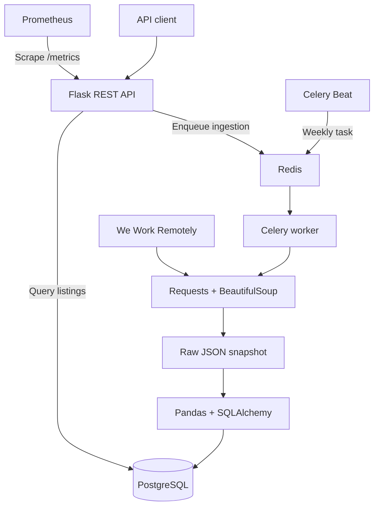

# Remote Jobs Data Pipeline

**Automated collection, relational storage, and API access for remote job listings.**

A Python data engineering project that collects job listings from [We Work Remotely](https://weworkremotely.com/), cleans and deduplicates the extracted records, stores them in PostgreSQL, and exposes them through a searchable REST API.

The repository brings together an ingestion workflow, asynchronous execution, scheduled collection, and API instrumentation in a modular codebase.

> **Status — Development prototype.** The current implementation targets We Work Remotely using Requests and BeautifulSoup. An earlier Emploi.ci browser experiment remains in `test_browser.py` but is not part of the active pipeline. Full Docker deployment is currently blocked by unresolved merge markers in the committed `Dockerfile`.

## Project scope

The project explores how to turn public job listings into a structured dataset that downstream applications can query without scraping the source on every request.

The current implementation includes:

- HTML extraction from one remote job category.
- A JSON intermediate dataset separating extraction from database loading.
- Data cleaning and deduplication with Pandas.
- Relational storage with SQLAlchemy and PostgreSQL.
- A REST API with pagination, search, and filters.
- Background ingestion through Celery and Redis.
- Weekly scheduling through Celery Beat.
- API metrics exposed for Prometheus.

It does not currently include a job-search frontend, full-site crawling, or a completed market analytics dashboard.

## Architecture



| Component | Responsibility | Implementation |
|---|---|---|
| Extraction | Fetch and parse listing cards | Requests, BeautifulSoup |
| Transformation | Clean strings, fill missing values, remove duplicate records | Pandas |
| Persistence | Store companies and job listings | PostgreSQL, SQLAlchemy |
| API | Expose listings and enqueue ingestion | Flask, Flask-RESTX |
| Task execution | Run ingestion outside the HTTP request lifecycle | Celery, Redis |
| Scheduling | Enqueue recurring ingestion | Celery Beat |
| Instrumentation | Expose HTTP metrics | Prometheus Flask Exporter |
| Container orchestration | Define application and infrastructure services | Docker Compose |

## Ingestion workflow

### 1. Extract

The scraper requests:

```text
https://weworkremotely.com/categories/all-other-remote-jobs
```

It extracts the following fields from listing cards:

| Field | Description |
|---|---|
| `id_externe` | Identifier derived from the listing URL |
| `url` | Link to the original listing |
| `titre_poste` | Job title |
| `nom_entreprise` | Company name |
| `region` | Geographic eligibility |
| `type_contrat` | Contract or employment type |
| `salaire` | Salary text, when available |
| `tags` | Additional labels |
| `logo_url` | Company logo URL |
| `date_publication` | Publication date text displayed by the source |

The output is written to:

```text
scraper/raw_data/donnees_brutes.json
```

Each execution replaces this file. It is an intermediate snapshot, not an archive of previous runs.

**Collection boundaries:** one category page, no pagination, and no requests to individual job detail pages. Extraction limits are upper bounds; the number of available listing cards determines the actual result.

### 2. Transform

The cleaning stage:

1. Loads the JSON snapshot into a DataFrame.
2. Removes duplicate records using `id_externe`.
3. Strips leading and trailing whitespace from string values.
4. Replaces missing values with a placeholder.
5. Resolves company records before inserting job listings.

Salary and publication date values remain strings. Currency conversion, salary normalization, and date parsing are outside the current implementation.

### 3. Load

Data is stored in two related tables:

| Table | Purpose |
|---|---|
| `entreprises` | Unique company names and internal identifiers |
| `offres` | Job listing attributes and a foreign key to the company |

Database constraints enforce uniqueness on company names and external listing identifiers.

**Loading behavior is insert-only:** existing listings are skipped. Changes to previously collected listings are not propagated, and listings removed from the source are not marked as expired.

## API surface

The API exposes the following routes:

| Method | Endpoint | Purpose |
|---|---|---|
| `GET` | `/api/v1/offres` | Retrieve and filter listings |
| `GET` | `/api/v1/offres/{id}` | Retrieve a listing by its internal database ID |
| `POST` | `/api/v1/scrape/async` | Enqueue an ingestion task |
| `GET` | `/docs` | Open the Swagger UI |
| `GET` | `/metrics` | Retrieve Prometheus metrics |

### Search and pagination

Supported parameters for `GET /api/v1/offres`:

| Parameter | Default | Behavior |
|---|---|---|
| `page` | `1` | Page number |
| `limit` | `10` | Results per page |
| `query` | — | Case-insensitive search across job title, tags, and company name |
| `region` | — | Case-insensitive region filter |
| `contrat` | — | Case-insensitive contract type filter |

Example request:

```bash
curl "http://localhost:5000/api/v1/offres?query=python&region=EMEA&page=1&limit=20"
```

The response schema contains pagination metadata and listing records:

```json
{
  "page": 1,
  "limit": 20,
  "total_items": 0,
  "data": []
}
```

Search operates on stored records; it does not trigger a new collection.

### Background ingestion

```bash
curl -X POST "http://localhost:5000/api/v1/scrape/async"
```

The endpoint returns HTTP `202 Accepted` with a task identifier. This acknowledges task submission, not successful completion. A task-status HTTP endpoint is not currently implemented.

## Running locally

The commands below assume a Bash-compatible environment, such as Linux or WSL2, with Python 3.10, Docker, and Docker Compose available.

This workflow starts PostgreSQL and Redis in containers while running the Python application locally. It does not build the application image.

### 1. Set up the Python environment

```bash
git clone https://github.com/Fred-Sonta/Auto-webscraping-Pipeline.git
cd Auto-webscraping-Pipeline

python3.10 -m venv .venv
source .venv/bin/activate
python -m pip install -r requirements.txt

mkdir -p scraper/raw_data
```

Run subsequent application commands from the repository root.

### 2. Configure the environment

Create an untracked `.env` file:

```dotenv
# Python application
DB_USER=emploi
DB_PASSWORD=replace_with_a_local_password
DB_HOST=localhost
DB_PORT=5432
DB_NAME=observatoire_emploi
REDIS_URL=redis://localhost:6379/0

# PostgreSQL container initialization
POSTGRES_USER=emploi
POSTGRES_PASSWORD=replace_with_a_local_password
POSTGRES_DB=observatoire_emploi
```

Keep `POSTGRES_USER`, `POSTGRES_PASSWORD`, and `POSTGRES_DB` aligned with their corresponding application settings.

The PostgreSQL image uses `POSTGRES_*` variables when initializing a new database volume. Changing these values later does not reconfigure an existing database.

### 3. Start infrastructure services

```bash
docker compose up -d db redis
```

Wait for PostgreSQL to become healthy before starting the application.

### 4. Run a manual ingestion

```bash
python -m scraper.main
```

The manual entry point extracts up to **50 listings**, then runs cleaning and database loading.

### 5. Start the API

```bash
python -m api.app
```

Default local endpoints:

- API: `http://localhost:5000/api/v1/offres`
- Swagger UI: `http://localhost:5000/docs`
- Metrics: `http://localhost:5000/metrics`

The current entry point uses Flask's development server with debug mode enabled.

### 6. Enable background execution

In another terminal, activate the same virtual environment and run:

```bash
celery -A tasks.celery_app worker --loglevel=info --pool=solo
```

The Celery task extracts up to **150 listings**, then runs the same cleaning and loading stages.

To enable scheduled ingestion, start a separate scheduler:

```bash
celery -A tasks.celery_app beat --loglevel=info
```

The configured schedule is **Monday at 02:00, `Africa/Abidjan` time**.

Use one worker and one scheduler for local evaluation. Concurrent ingestion runs share the same intermediate JSON path and are not isolated.

## Containers and observability

`docker-compose.yml` defines seven services:

| Service | Role | Published port |
|---|---|---|
| `db` | PostgreSQL | `5432` |
| `redis` | Celery broker and result backend | `6379` |
| `api` | Flask application | `5000` |
| `celery_worker` | Background task execution | — |
| `celery_beat` | Periodic task scheduling | — |
| `prometheus` | Metrics collection | `9090` |
| `grafana` | Visualization service | `3000` |

PostgreSQL data is persisted in a named Docker volume.

Prometheus is configured to scrape the API's `/metrics` endpoint every **15 seconds**. This provides API instrumentation; dedicated ingestion metrics, data-quality indicators, and alerting rules are not implemented.

The Grafana dashboard JSON files are currently empty, and datasource/dashboard provisioning is not configured.

**Full application deployment through Compose remains blocked by the unresolved conflict in `Dockerfile`.**

## Repository structure

```text
.
├── api/
│   ├── app.py                  # Application setup, Swagger, and metrics
│   ├── routes.py               # Query endpoints and ingestion trigger
│   └── schemas.py              # API response models
├── db/
│   ├── database.py             # Engine and session configuration
│   └── models.py               # Company and listing models
├── scraper/
│   ├── main.py                 # Manual ingestion entry point
│   ├── spiders/
│   │   └── offres_spider.py     # Active WWR extraction logic
│   └── cleaners/
│       └── cleaner.py          # Data cleaning and database loading
├── tasks/
│   ├── celery_app.py           # Broker configuration and weekly schedule
│   └── tasks.py                # Background ingestion task
├── monitoring/
│   ├── prometheus.yml
│   └── grafana/dashboards/     # Dashboard placeholders
├── tests/
├── test_browser.py             # Earlier Emploi.ci browser experiment
├── Dockerfile
├── docker-compose.yml
└── requirements.txt
```

## Current limitations

The implementation demonstrates the component boundaries of an ingestion service. Several areas require further work before production use:

- **Identifier reliability:** `id_externe` uses the final hyphen-separated URL fragment. This can produce collisions and incorrectly skip distinct listings.
- **Failure propagation:** some extraction and loading exceptions are logged without being re-raised. A task can therefore report success despite an unsuccessful ingestion.
- **Extraction resilience:** the scraper depends on source HTML selectors and does not currently validate HTTP status codes or implement retries.
- **API hardening:** authentication, rate limiting, strict pagination bounds, and production server configuration are absent.
- **Database lifecycle:** tables are created with `create_all`; schema migrations are not implemented.
- **Runtime verification:** database-backed API responses and the complete ingestion workflow still require integration tests.

The existing cleaner tests exercise illustrative Python operations rather than the actual cleaning function. The API and scraper test modules are empty; the repository does not currently establish end-to-end correctness or measured test coverage.

## Development priorities

1. Restore a reproducible container build.
2. Introduce stable listing identifiers and explicit ingestion failure handling.
3. Add tests against the real parser, cleaning stage, persistence layer, and API.
4. Define update and expiration behavior for existing listings.
5. Normalize dates and salary information.
6. Add ingestion metrics and provision Grafana dashboards.
7. Harden API access, configuration, and deployment.

## Source and collection practices

Job listings originate from We Work Remotely; each stored record retains a link to its source.

The scraper identifies the project through its User-Agent. Automated `robots.txt` validation is not currently implemented. Before operating or extending the collector, review the source's current crawling rules and terms, and configure collection accordingly.
